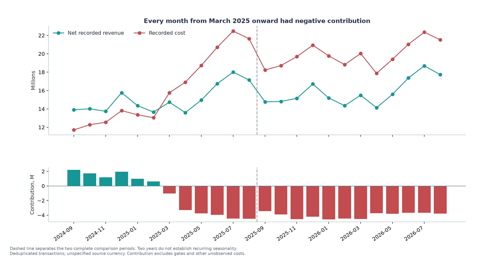
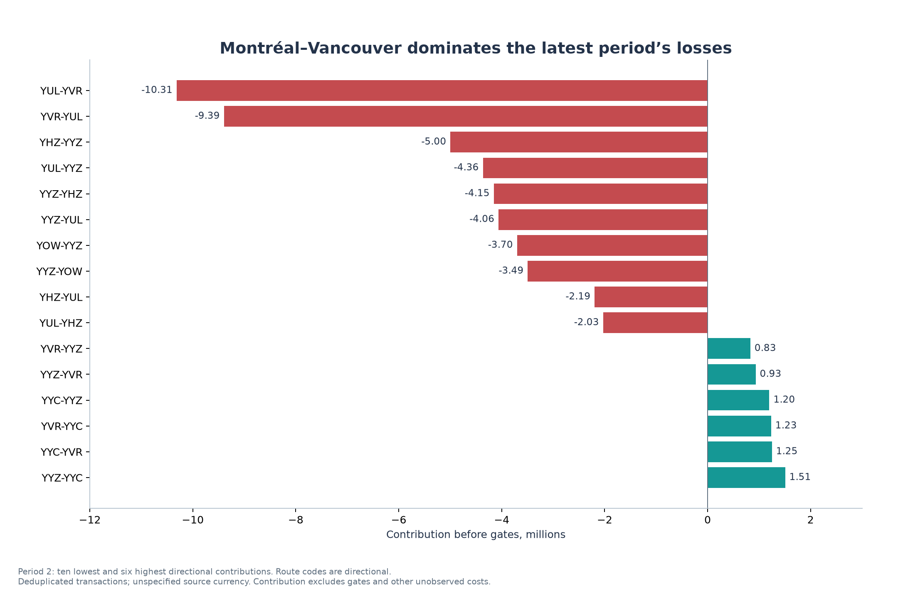
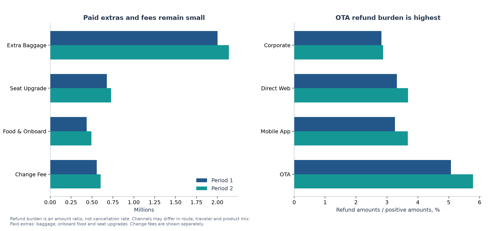

# Airline data analysis

Prepared 11 October 2026 from the local transaction, operating cost, and gate files. All amounts use the source's unspecified dollar currency. **Period 1 is September 2024–August 2025; Period 2 is September 2025–August 2026.**

The largest finding is a widening gap between recorded revenue and operating costs. Deduplicated revenue grew **5.19%**, while the four recorded cost categories grew **23.52%**. Contribution before gates and other unobserved costs deteriorated by **$36.02M**, from **−$12.36M to −$48.38M**. The data support prioritizing a review of activity growth and a few large loss-making markets.

This is an analysis of recorded transactions and costs. Transaction dates are payment activity, not proven flight or revenue-recognition dates. The calculated contribution is therefore a useful reconciliation and review measure, **not net income or confirmed flight profitability**. [Assumptions recorded before analysis](ASSUMPTIONS.md) explain every normalization and scenario.

**Deliverables:** [Excel workbook with supporting tables](analysis_workbook.xlsx) · [10-page chart PDF](analysis_charts.pdf) · [Reproduction instructions](README.md).

## 1. Network performance and timing

| Measure | Period 1 | Period 2 | Change |
| --- | ---: | ---: | ---: |
| Net recorded revenue | $180.63M | $190.00M | +5.19% |
| Crew, food, fuel, maintenance | $192.99M | $238.38M | +23.52% |
| Contribution before gates | −$12.36M | −$48.38M | −$36.02M |
| Contribution / revenue | −6.84% | −25.46% | −18.62 percentage points |
| Cost events | 13,072 | 15,729 | +20.33% |
| Revenue per cost event | $13,818 | $12,080 | −12.58% |
| Cost per cost event | $14,763 | $15,155 | +2.65% |
| Directions with negative contribution | 24 / 54 | 28 / 54 | +4 |

A cost event is one route and timestamp with exactly one crew, food, fuel, and maintenance record. It is a proxy for operating activity; the files contain no flight IDs, seats, passengers, distances, or load factors. Revenue per event must not be read as passenger yield.

**1. More activity did not produce proportionate recorded revenue.** Cost events grew 20.33%, ticket transactions grew about 5.20%, and net revenue grew 5.19%. Revenue per event fell much more than cost per event rose. This points to activity, route mix, or revenue timing as major review areas; the files cannot distinguish them conclusively.

**2. The gap persists across months.** September 2024–February 2025 had positive monthly contribution. Every month from March 2025 through August 2026 was negative. Period 2 monthly deficits ranged from $3.46M to $4.58M, so the annual result is not caused by a single bad month. Two years are insufficient to establish recurring seasonality.

**3. Partial route coverage explains some, but not most, deterioration.** Recorded cost activity first appears for London–Toronto in February 2025, Montréal–Ottawa in March, and Moncton–Halifax in April, in both directions. Actual launch dates are unknown. Comparing only the 612 route/calendar-month pairs with activity in both periods yields revenue growth of **3.87%** and cost growth of **19.74%**; contribution still falls **$31.11M**. The other 36 Period 2 route-months contribute **−$4.91M**, completing the network bridge. Matching coverage does not control activity intensity.

[Exact network totals](tables/network_period.csv) · [Monthly totals](tables/network_monthly.csv) · [Comparable route-months](tables/routes_comparable_months.csv)

## 2. Where to investigate first

**4. Montréal–Vancouver is the biggest concentration of losses.** Its two directions contributed **−$19.71M** in Period 2, accounting for **32.3% of gross losses across negative routes**. Combined revenue increased only **$0.40M**, while costs increased **$12.04M**. Contribution deteriorated **$11.64M**. Review both directions together: the gap between directions is much smaller than the combined shortfall.

| Direction | Period 2 contribution | Change from Period 1 |
| --- | ---: | ---: |
| Montréal → Vancouver, YUL–YVR | −$10.31M | −$6.08M |
| Vancouver → Montréal, YVR–YUL | −$9.39M | −$5.56M |
| Halifax → Toronto, YHZ–YYZ | −$5.00M | −$3.03M |
| Toronto → Halifax, YYZ–YHZ | −$4.15M | −$2.53M |
| Montréal → Toronto, YUL–YYZ | −$4.36M | −$2.44M |
| Toronto → Montréal, YYZ–YUL | −$4.06M | −$2.22M |

**5. A small group explains most deterioration.** The eight worst directional changes account for **71.3%** of the network's contribution decline. The review priority is therefore more focused than treating all 54 directions alike.

**6. Profitable directions provide a limited offset.** Period 2 has 26 positive directions contributing **$12.56M**, against **$60.93M** of gross losses on 28 negative directions. The leading positives are Toronto–Calgary (+$1.51M), Calgary–Vancouver (+$1.25M), Vancouver–Calgary (+$1.23M), and Calgary–Toronto (+$1.20M), before gate and unobserved costs.

**7. The patterns are generally market-wide.** Both directions have the same contribution sign in all 27 reverse-direction pairs in Period 2. That strengthens the case for reviewing two-way markets, while recognizing that revenue timing can differ by direction. The five largest directional routes by revenue represent 33.3% of the network, compared with 33.9% in Period 1.

**8. Thin positive routes are sensitive to gate assumptions.** In the equal-allocation gate scenario, both Vancouver–Victoria directions move from positive to negative contribution. Negative directions rise from 28 to 30 in Period 2. This is a scenario result; actual route gate use is not supplied.

The complete [route analysis](routes_findings.md), [all route results](tables/routes_period.csv), and [54-route monthly heatmap](charts/06_route_month_heatmap.png) show the full distribution. These figures do not justify route closures by themselves: avoidable versus fixed costs, schedules, capacity, and flight-linked revenue are missing.

## 3. Operating cost and gate insights

**9. Recorded cost growth is mainly associated with more events.** Holding Period 1's average cost per event fixed, additional events explain **$39.23M, or 86.4%**, of the $45.39M increase. The other **$6.16M** includes changes in cost per event and route mix; it is not a measure of pure inflation.

**10. Fuel and crew are the largest dollar drivers.** Fuel increased **$16.12M**, crew **$15.05M**, maintenance **$13.00M**, and food **$1.22M**. Food cost per event actually fell from **$598.43 to $574.70**; its total rose because there were more events. This distinction matters when choosing whether to investigate activity levels or spending per event.

**11. Activity grew very unevenly.** Moncton–Halifax cost events rose from 144 to 336, while Montréal–Ottawa rose from 280 to 546. Their first periods have partial coverage. Montréal–Vancouver events rose from 221 to 306 in one direction and 226 to 314 in the other, alongside large increases in recorded costs.

**12. Gate row totals substantially overstate physical gate charges.** The source repeats each gate charge across its assigned routes. Counting each physical gate once gives **$9.6644M** and **$9.8777M**, rather than row sums of $17.4233M and $17.8196M. Physical gate charges grew only **2.21%**. Halifax A3 and Ottawa A2 have no assigned route; their charges total **$425,700** and **$433,500** and remain network costs.

**13. The illustrative gate scenario deepens the deficit.** Mapping the gate labels to the two analytical September–August periods yields contribution after all physical gates of **−$22.02M** and **−$58.25M**. The mapping is an explicit assumption. Shared charges are allocated equally across listed routes only for route scenarios; unassigned gates remain unallocated. These figures still omit other overhead.

[Cost and gate deep dive](costs_gates_findings.md) · [Gate reconciliation](tables/gate_period.csv) · [Route gate scenario](tables/gate_route_contribution_scenario.csv)

## 4. Revenue mix, refunds, and booking behavior

**14. Tickets dominate the revenue model.** Period 2 positive amounts comprise **$193.87M of tickets**, **$3.36M of paid extras**, and **$0.60M of change fees**. Tickets represent about **98.0%** of positive recorded amounts. Baggage is the largest paid extra, at **$2.14M**; seat upgrades contribute $0.73M and onboard food $0.49M. Amounts are recorded transactions, not proven passenger fares.

**15. Refunds are growing faster than sales activity.** Refund outflow rose **17.2%**, from **$6.68M to $7.83M**, compared with **5.6%** growth in positive amounts. Refund burden increased from **3.57% to 3.96%** of positive amounts. The additional $1.15M of refunds absorbs part of the ticket revenue increase. This is an amount ratio, not a cancellation rate.

**16. The OTA channel warrants a refund review.** Period 2 refund burden is approximately **5.8% for Online Travel Agency**, versus **3.7% for Direct Web and Mobile App**, and **2.9% for Corporate Portal**. A causal explanation requires product, traveler, itinerary, and policy data; the dataset does not provide them.

**17. Add-on attachment edged down as recorded extras grew.** Among bookings with a ticket in the same period, paid-extra attachment fell from **39.6% to 39.1%**. Qualifying ticket bookings grew **5.3%**. All paid-extra revenue grew **7.9%**, but the same-period ticket-booking cohort grew **4.1%** in paid-extra amounts. These are different denominators: **$118,889.69** of Period 2 extras belongs to bookings with a ticket recorded in the earlier period and is excluded from the same-period attachment cohort. That carryover amount equals **48.2%** of the total paid-extra dollar increase, highlighting the effect of cohort timing on the comparison.

**18. The channel mix is stable, with Direct Web largest.** Period 2 net revenue shares are Direct Web **40.1%**, Mobile App **21.9%**, OTA **19.7%**, and Corporate Portal **18.3%**. Channel attachment rates are close, around 38–40%, so the file offers little evidence of a large observed attachment advantage for one channel.

**19. Ticket values differ little between Direct Web and OTA after measured mix adjustment.** With identical route/month weights, Period 2 average recorded ticket transaction values are **$1,030.21 for Direct Web and $1,034.94 for OTA**, a $4.73 gap. This comparison adjusts route and month composition, not traveler, product, lead time, or commissions. It does not show net channel profitability.

**20. Membership analysis is sensitive to how the cohort is defined.** Non-Member transactions supply **49.3%** of Period 2 net revenue; Blue supplies 24.5%, Silver 13.7%, Gold 8.0%, and Platinum 3.0%. The raw booking group with inconsistent tiers appears to have **88.0%** add-on attachment. When the cohort uses only ticket-transaction tiers, that group shrinks from **2,660 to 219 bookings** and attachment falls to **49.8%**. This is a strong example of a grouping artifact; mixed or unknown tiers should not be interpreted as customer segments.

**21. Payment exposure is concentrated in cards.** Credit Card accounts for **64.0%** of Period 2 net recorded amounts, Debit 20.5%, Points + Cash 10.6%, and Travel Voucher 4.0%. These are transaction labels, not cash-flow or loyalty-liability accounting; points valuation and settlement data are absent.

[Commercial deep dive](commercial_findings.md) · [Revenue categories](tables/commercial_revenue_mix.csv) · [Ticket-tier robustness check](tables/commercial_attachment_by_ticket_tier.csv)

## 5. How large would a change need to be?

The following sensitivities use Period 2, holding all other amounts and activity fixed. They are arithmetic illustrations, not forecasts.

| Scenario | Improvement / deterioration | Contribution before gates |
| --- | ---: | ---: |
| Baseline | — | −$48.38M |
| Net revenue +5% | +$9.50M | −$38.88M |
| Recorded operating cost −5% | +$11.92M | −$36.46M |
| Revenue +5% and cost −5% | +$21.42M | −$26.96M |
| Refund outflow −10% | +$0.78M | −$47.59M |
| Paid extras +10% | +$0.34M | −$48.04M |
| Fuel cost +10% | −$8.32M | −$56.70M |

**22. Small ancillary or refund improvements cannot close this recorded gap alone.** Break-even before gates would require approximately **25.46% more net revenue**, or **20.29% less recorded operating cost**, if the other side were fixed. Neither is a forecast or a feasible operating plan without demand, capacity, and cost-avoidability data. The relative scales prioritize the investigation: activity and large route deficits deserve more attention than small commercial optimizations.

[Exact sensitivity table](tables/network_sensitivity.csv) · [Sensitivity chart](charts/10_sensitivity.png)

## 6. Data quality, confidence, and next actions

The analysis contains **558,129 unique transactions**, **353,002 booking IDs**, **115,204 cost rows**, **28,801 complete cost events**, **54 directions**, and **24 months**. Revenue and cost cover exactly the same **1,260 route-month cells**. Every booking ID has at least one ticket somewhere in the data; 13,149 have multiple ticket transactions and 12,912 span multiple routes. Booking IDs are not unique customers, and these patterns do not prove duplicate bookings.

The 1,856 verified duplicate transaction rows were removed only from the analysis dataset. This reduces revenue by **$1,230,798.17** versus the existing source reports. All normalized fields match within each duplicate ID, and the reconciliation is exact by calendar year. The original CSVs, workbooks, and reports remain intact.

Category aliases and capitalization are normalized; unknown membership and payment values remain explicitly unknown. The eleven unresolved transaction dates represent **$7,195.42** of gross amounts. Under the alternative D/M/Y interpretation, Period 1 revenue changes by **−$1,131.98**, Period 2 by **+$7.87**, and **$1,124.11** moves beyond the observed window. These amounts do not explain the network deficit. The larger set of date corrections continues to depend on the previously documented transaction-ID ordering evidence.

The checks reconcile revenue to the prior reports less duplicates, match route/month rollups to network totals, verify four cost categories per event, reconcile physical gates and allocations, and check booking-cohort denominators. Source hashes are retained in [preparation_audit.json](preparation_audit.json).

Recommended sequence:

1. **Fix the reporting baseline.** Use deduplicated transaction IDs, canonical category mappings, and an explicit date rule. Preserve the removed-row and date-decision audit trails. Keep calendar-year partial coverage visible.
2. **Review the three largest deteriorating markets.** Start with Montréal–Vancouver, Toronto–Halifax, and Toronto–Montréal. Obtain flight IDs, departure dates, schedules, capacity, ticket-to-flight allocations, and cost-allocation definitions to distinguish an operating shortfall from timing or scope differences.
3. **Review activity additions and partial coverage.** Evaluate cost-event growth and the six directions first recorded during Period 1 using comparable months and verified service dates.
4. **Investigate OTA refunds and booking timing.** Link refunds to original ticket transactions and policies. Measure post-ticket behavior across periods without dropping old bookings from the numerator or silently changing the denominator.
5. **Confirm gate-period and overhead treatment.** Establish the actual dates represented by gate year labels, identify the two unassigned gates, and choose an allocation based on measured use if route decisions require it.

The dataset cannot support load factors, passenger yield, customer retention, lifetime value, actual departure profitability, channel commissions, or net income. Those require additional fields rather than stronger assumptions.
