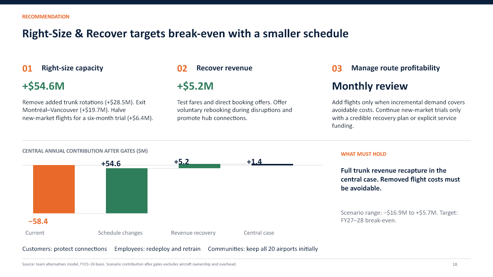
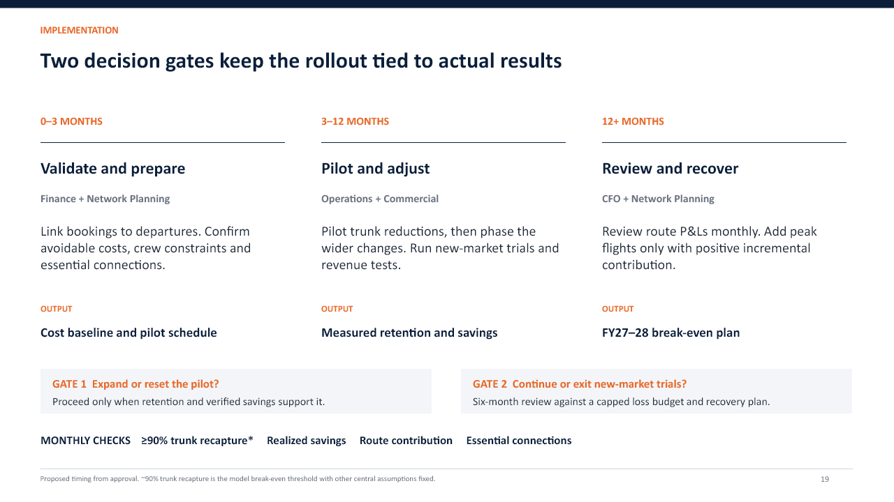
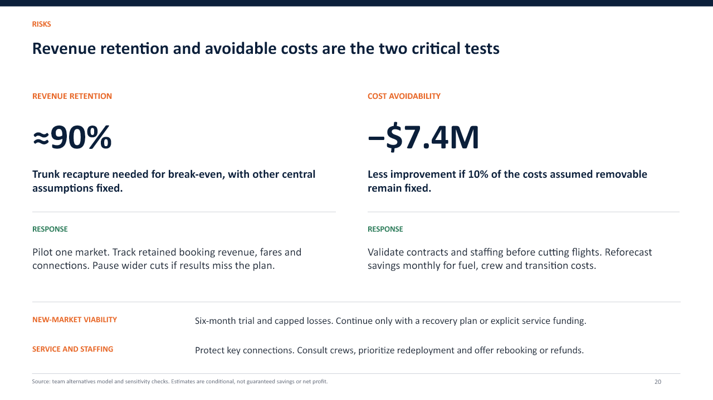

# NorthByte presentation

[Download the editable PowerPoint](NorthByte_FirstByte2026_template.pptx)

Slides 18–20 contain the recommendation, implementation plan and risks. Their speaker notes include the assumptions and talking points. The other 24 slides are unchanged from commit `f581f8b`.

## Rebuild slides 18–20

The editable PowerPoint and previews are checked in. You can open them without running any scripts.

The generator uses Python 3.10+ and its standard library only. No Node.js, JavaScript, Codex runtime or additional Python packages are required for this slide builder. Install Montserrat and Lato for consistent display in PowerPoint.

Sources:
- `build_recommendation.py`: command-line entry point.
- `render_recommendation.py`: fills the editable OOXML layouts with text and speaker notes.
- `merge_recommendation.py`: replaces only slides 18–20 and their notes, checking every other package entry stays identical.
- `recommendation_content.json`: slide text, keyed by slide number and layout placeholder.
- `recommendation_notes.json`: speaker notes.
- `layouts/slide-18.xml` through `slide-20.xml`: editable PowerPoint shape layouts, including positions, font settings and colors. These are source templates, not executable JavaScript.

From the repository root:

```sh
python slides/build_recommendation.py
```

Creates `slides/generated/NorthByte_FirstByte2026.pptx`. The generated folder is ignored by Git. To update the tracked deck after reviewing changes:

```sh
python slides/build_recommendation.py --in-place
```

Optional arguments: `--output path/to/deck.pptx`, `--deck path/to/base.pptx`, and `--content path/to/content.json`.

Edit the text in JSON without changing the placeholder keys. To change positions, sizes or colors, edit the corresponding XML shape layout. Coordinates use EMUs (914400 per inch); font sizes use hundredths of a point. The financial bridge consists of editable shapes: if its figures change, update the bar geometry as well as the text. Text does not automatically resize to fit; review longer wording in PowerPoint.

Run this builder after scripts that regenerate the base deck. It expects the 27-slide NorthByte presentation and verifies the section labels at pages 18–20. It does not rerun financial analysis. It preserves all other slides, charts and media. Layouts must remain text/shapes without external relationships.

The checked-in PNG previews show the approved layout. This pure-Python builder does not render new PNG previews; after changing content, inspect the PPTX and export slides 18–20 from PowerPoint to refresh the previews. No automatic commit or upload is performed.

## Slide 18 — Recommendation



## Slide 19 — Implementation



## Slide 20 — Risks


